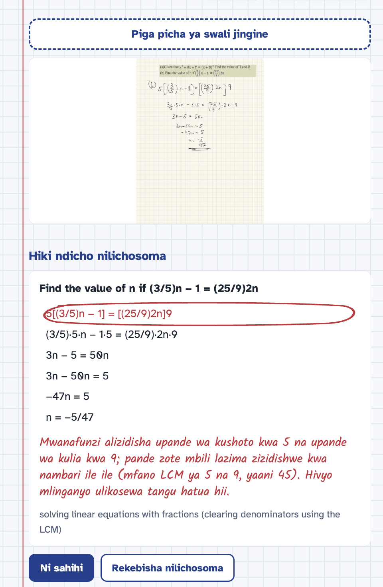
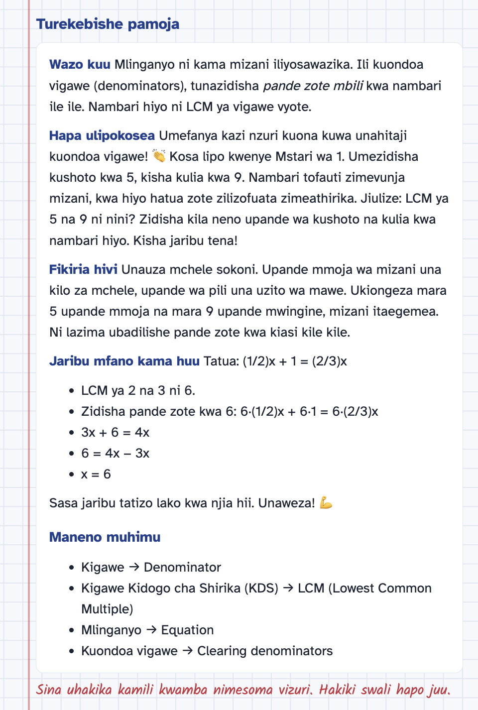
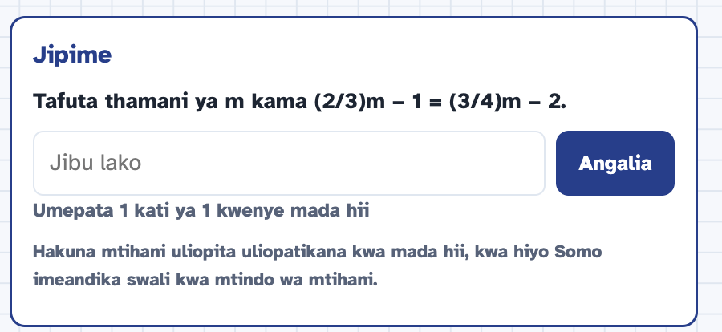
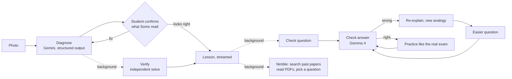
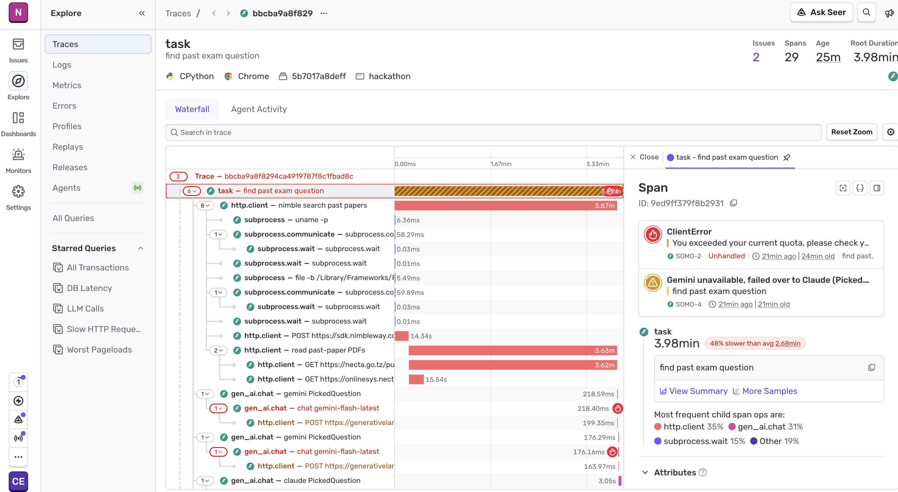

# Somo

**Snap the problem you're stuck on. Somo finds the exact step where you went wrong, then teaches it in the language you think in, aligned to the exam you'll sit.**

*Somo* is Swahili for "lesson." It was built in one day at the [AI Engineer NYC Hackathon](https://www.mlh.com/events/ai-engineer-nyc-2026) (MLH, October 11, 2026).



---

## Why Somo exists

In Tanzania, students learn in Swahili through primary school, then switch to English for secondary school and sit high-stakes NECTA national exams in a language they are still learning. In New York public schools, many English learners face the same barrier. In both places, students often **understand the math but get stuck on the words**, and private tutoring is out of reach for most families.

General-purpose AI chat tools can solve the problem for a student, but they don't diagnose *why* that student got it wrong. They rarely teach in the student's home language with local context, and they don't connect practice to the exam the student will actually face. Somo is built around those three gaps.

**Who it's for**

| | Tanzania | United States |
| --- | --- | --- |
| Student | Form 1–4 secondary student | Public school student, especially English learners |
| Language gap | Swahili at home, English in class and exams | Spanish, Swahili, Arabic and others at home, English in class |
| Tested on | NECTA national exams (FTNA, CSEE) | State standards / NY Regents |
| Constraint | Low-cost Android phone, patchy data | Limited tutoring, weak home internet for some families |

Somo works for any subject in principle. The prototype starts with **math**, because a wrong step in math is precise and can be verified, which makes it the right place to prove the approach before moving to the sciences, where the vocabulary gap is often widest.

---

## What it does

1. **Snap.** The student photographs a problem and their handwritten working.
2. **Diagnose.** Somo reads the handwriting, names the concept, and finds the **first line** where the working goes wrong. That line is circled in red pen, with a short teacher's note in the student's language.
3. **Confirm.** Somo shows "Here's what I read." The student taps **Looks right** or **Fix what I read** and types the problem. Somo re-reads the photo with that correction before teaching anything.
4. **Teach.** A short lesson streams in, in English, Swahili or Spanish: the idea in plain words, where it went wrong, an analogy from the student's world (daladala fares and market scales in Dar es Salaam, subway swipes and bodega prices in New York), a worked example with *different* numbers, and bilingual key terms (home language → English exam term). Somo does not give away the answer to the student's own problem.
5. **Check.** One quick question tests the concept.
   - **Wrong:** Somo re-explains more simply with a *new* analogy, then asks an easier question.
   - **Right:** the student can try a harder question, or **practice like the real exam**.
6. **Practice like the real exam.** Somo finds a real past exam question on the same concept on the live web (NECTA past papers for Tanzania, NY Regents questions for the US) and shows it with a link to the source paper. The student answers it right there, and Somo grades it.

At any point, the student can switch language or curriculum and tap **Teach me again in Spanish** (or Swahili, or English) to get the same lesson re-taught.




---

## How it works



Every model call goes through one router: **Gemini first, Claude as automatic failover.** Every call is traced in **Sentry**.

| Step | Model or service | Why |
| --- | --- | --- |
| Read handwriting, diagnose the mistake | Gemini (`gemini-flash-latest`), structured JSON | Strong multimodal reading; schema-checked output |
| Verify the answer independently | Gemini | A second, blind solve catches confident mistakes |
| Teach, re-explain, write questions | Gemini, streamed | Fast first words; multilingual |
| Grade answers, compare answers | Gemma 4 (`gemma-4-26b-a4b-it`) | Small, fast and cheap enough for frequent checks |
| Find real past exam questions | Nimble search + PDF reading + Gemini | Live web context the model doesn't have |
| Failover when Gemini is down | Claude (`claude-sonnet-5-5`) | Keeps the demo and the student moving |
| Observability | Sentry tracing and issues | See every call, its timing, and every failover |

---

## Design decisions

### AI engineering

**Diagnose, don't just solve.** A tutor that only gives the right answer teaches very little. Somo's diagnosis returns a structured object (`transcription`, `concept`, `error_step`, `error_explanation`, `final_answer`, `reading_confidence`) so the UI can point at the exact line, and the lesson can focus on that one misconception.

**Structured outputs everywhere.** Every model response that drives the UI is validated against a Pydantic schema (Gemini's `response_schema`, Claude's JSON-schema output mode). No regex-parsing of free text, and a malformed answer gets retried instead of breaking the page.

**Self-verification before teaching.** A second model call solves the transcribed problem *without seeing the diagnosis*. If the two final answers disagree, or the handwriting was hard to read, Somo marks the lesson as low confidence and tells the student: *"I'm not fully sure I read this right. Check the problem above before trusting this lesson."* Answers are compared with a fast string normalizer first ("B = 4 and T = 16" equals "T = 16, B = 4"), and Gemma is only asked when that fails.

**Verification catches solving errors, not reading errors.** While building, we found that when the photo itself is ambiguous (a printed exam question that lost its exponent formatting), both calls agree on the same wrong reading. That's why the **human-in-the-loop confirm step** exists: the student, who can see the paper, confirms or corrects what Somo read before any teaching happens.

**Model routing by job.** Gemini does the hard multimodal reasoning. Gemma 4 does high-frequency, low-stakes checks (grading and answer equivalence), where speed and cost matter more than depth. This split is also the basis for a future offline mode.

**Multi-provider failover with a circuit breaker.** All calls go through `llm.py`:
- Gemini gets a 15-second budget and one quick retry on a `503`/`429`.
- A timeout skips the retry (it already used the budget) and fails over to Claude straight away.
- After a quota or overload error, a **circuit breaker** sends calls straight to Claude for 60 seconds instead of failing again and again.
- Streams only fail over *before* the first word, so a lesson never switches provider mid-sentence.

This came from necessity: Gemini's free tier ran out of quota mid-build, and the failover kept everything running. Diagnosis time dropped from about 116 seconds (retrying an overloaded model) to 9–12 seconds.

**Hiding latency with parallel work.** When the lesson starts streaming, three things run in the background at once: verification of the answer, the check question, and the Nimble search for a real exam question. By the time the student finishes reading, the check question is usually ready and the past-paper search is well underway.

**Honest sourcing.** Practice questions are labeled with one of three kinds:
- **Past exam paper:** from an official paper or examiner report (gets the exam stamp, such as "NECTA CSEE 2023").
- **Practice question from the web:** a real question from a textbook or worksheet site, linked, with no exam stamp.
- **Written by Somo:** no suitable question was found, and the card says so.

We added this after catching our own pipeline presenting a UK worksheet as a "real past exam" question. Somo also checks that the chosen question tests the **same concept**; a real NECTA question on surds is rejected when the student is learning completing the square.

**Reading the papers, not the snippets.** Nimble finds the right NECTA documents, but search results for PDFs come back as short summaries. When a result is a short PDF, Somo downloads it and reads up to 20,000 characters of its text, five papers in parallel. NECTA's *Candidates' Item Response Analysis* reports turned out to be especially useful, because they quote every exam question word for word.

**Caching that survives restarts.** Found practice questions are saved to `practice_cache.json`, with fuzzy topic matching ("simultaneous linear equations" matches "…by elimination"), so a topic is only searched once.

**Observability that found a real bug.** Sentry traces every Gemini, Claude, Gemma and Nimble call, and raises a warning issue whenever Gemini fails over to Claude. The trace waterfall showed one NECTA server taking **3.6 minutes** to serve a PDF: httpx's timeout applies per chunk, so a slowly trickling download never tripped it. We added a hard 12-second deadline per file.



**Privacy by default.** No student photos or prompt text are sent to Sentry (`send_default_pii=False`; spans carry only model names, timings and outcomes). Sessions live in memory and disappear when the server restarts. Nothing about a student is stored.

### Product and interface

**An exercise book, not a chat app.** The interface looks like a page from a school exercise book: blue grid paper, a red margin line, ballpoint-blue text. Students already know how to read this page, and corrections arrive where teachers put them: a **red pen loop** drawn around the wrong line, with a handwritten note beside it. That loop is the one animated moment in the app; everything else stays quiet.

**Type chosen for learners.** Everything students read is set in *Atkinson Hyperlegible*, a typeface designed to keep similar characters distinct, which helps young readers and readers in a second language, especially on small, low-cost screens. *Kalam*, a handwriting face, is used only for the teacher's pen marks.

**One column, phone first.** A single centered column, readable at 390px wide, with big tap targets. Photos are resized and converted to JPEG on the phone before upload, so slow data stays usable, and iPhone HEIC photos work with every model.

**The interface speaks the student's language too.** Buttons, labels and messages switch between English, Swahili and Spanish, not just the lesson text.

**Guide, don't give away.** The lesson works an example with different numbers and leaves the student's own problem for them to fix. A wrong check answer gets a hint, not the answer.

**Errors give direction.** Every failure says what happened and offers **Try again**, in the student's language.

---

## Sponsor technologies

| Sponsor | How Somo uses it |
| --- | --- |
| **Google Gemini** | Primary model for reading handwriting, diagnosis, verification, teaching and question writing (`google-genai` SDK, structured output, streaming) |
| **Gemma 4** (via Gemini API) | Grading check answers and judging answer equivalence: the fast, cheap path, and the basis for offline mode |
| **Nimble** | Live web search for NECTA and Regents past papers (official past-paper sites first, open web as a fallback) |
| **Sentry** | Tracing for every model and web call, failover warnings, and the bug fix described above |
| **Claude** | Automatic failover when Gemini is overloaded or out of quota |

---

## Running it

**Requirements:** Python 3.10+, and API keys for Gemini, plus optionally Claude, Nimble and Sentry.

```bash
git clone https://github.com/Colin-J-Emmanuel/Somo.git
cd Somo
python3 -m venv .venv && source .venv/bin/activate
python -m pip install -r requirements.txt
```

Create a `.env` file in the project root:

```
GEMINI_API_KEY=...        # required
ANTHROPIC_API_KEY=...     # optional: enables failover to Claude
NIMBLE_API_KEY=...        # optional: enables real past-paper practice
SENTRY_DSN=...            # optional: enables tracing
```

Start the server and open http://localhost:8000:

```bash
python -m uvicorn app:app --reload --host 0.0.0.0 --port 8000
```

To use it from a phone on a network that blocks device-to-device traffic (common at venues), share it through a tunnel:

```bash
cloudflared tunnel --url http://localhost:8000
```

**Useful commands**

```bash
python smoke_test.py                       # check the Gemini and Gemma keys work
python pipeline.py samples/problem_3.png   # diagnose + verify one photo from the command line
python practice.py "solving simultaneous linear equations" tanzania   # find (and cache) a past-paper question
```

Run `practice.py` once for each demo topic before presenting; afterwards that topic's practice question loads instantly.

---

## Project structure

```
app.py            FastAPI routes; serves the UI from static/
pipeline.py       Diagnosis and verification (schemas, answer matching)
llm.py            Model router: Gemini → Claude failover, circuit breaker, streaming
practice.py       Nimble search, PDF reading, question picking, honest labels, disk cache
prompts.py        Every prompt in one place
config.py         Models, languages, curricula, timeouts, past-paper sites
sessions.py       In-memory sessions and per-concept mastery tally
observability.py  Sentry setup and span helpers (does nothing without SENTRY_DSN)
static/index.html The whole interface: one file, plain HTML, CSS and JavaScript
samples/          Real handwritten test problems
smoke_test.py     API key check
CLAUDE.md         Build plan and instructions for coding agents
```

**API**

| Route | Purpose |
| --- | --- |
| `POST /api/diagnose` | Photo + language + curriculum → diagnosis; starts verification in the background |
| `POST /api/correct` | The student's correction of what Somo read → a fresh diagnosis |
| `GET /api/lesson` | Streams the lesson (Server-Sent Events), then verification and a check question |
| `POST /api/check` | Grades an answer (Gemma), returns feedback and mastery |
| `GET /api/reexplain` | Streams a simpler explanation, then an easier question |
| `GET /api/next` | A harder (or easier) question on the same concept |
| `GET /api/practice` | A real past exam question on the concept, with its source |
| `GET /api/config` | Languages and curricula for the UI |

---

## Known limitations

- **Math only, so far.** The pipeline works for any subject in principle, but prompts and testing focused on secondary-school algebra.
- **Ambiguous photos.** If the printed question itself is ambiguous (for example, exponents that lost their formatting), Somo can misread it. The confirm step and the low-confidence warning are the safeguards.
- **Past-paper search is live and can be slow** the first time for a topic (up to about 30 seconds), because it downloads and reads full PDFs. Results are cached afterwards. Some topics have no matching question in the papers Nimble finds; Somo then writes one and labels it as such.
- **Scanned papers** with no text layer can't be read yet (no OCR).
- **No accounts or saved progress.** Sessions and the mastery tally reset when the server restarts.
- **Three languages** in the interface (English, Swahili, Spanish). Lessons could support many more.
- **Not yet tested with students.** All the problems used in development were written by the team.

---

## What's next

- **Offline mode on Gemma.** Run grading and simple re-explanations on the phone or a school laptop, for classrooms with little or no connectivity.
- **Full syllabus coverage.** Map NECTA Form 1–4 and NY Regents topics so lessons, check questions and past-paper practice follow the syllabus.
- **Beyond math.** Biology, chemistry and physics, where the vocabulary gap between home language and exam language is often widest.
- **A past-paper library.** Index NECTA papers and examiner reports ahead of time (with OCR for scanned papers) instead of searching live.
- **Progress over time.** Student accounts, a mastery map by topic, and spaced review of past mistakes.
- **Voice.** Lessons read aloud in Swahili and Spanish for younger students and early readers.
- **Teacher view.** The most common misconceptions in a class, so teachers know what to reteach.
- **Pilots** with secondary schools in Dar es Salaam and public schools in New York, measured on whether students fix their own mistakes, not just whether they reach the answer.

---

## Team

Built by **Colin Emmanuel** at the AI Engineer NYC Hackathon.